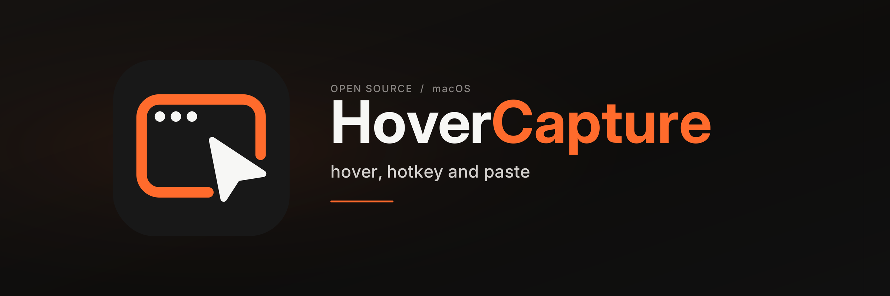

# HoverCapture

简体中文 · [English](README.md)

**鼠标停在哪个窗口，按一次快捷键，就截取那个窗口。** 图片自动保存为 PNG，并放入剪贴板，随时可以粘贴。

HoverCapture 是原生 macOS 菜单栏应用，不需要 Hammerspoon、浏览器扩展或单独运行的命令行服务。

## 0.2.2 RC4：Tahoe 程序坞窗口选择修复候选版

[下载 RC4（构建 8）](https://github.com/GESANGTAJIE/HoverCapture/releases/tag/v0.2.2-rc.4)。**仍待受影响的 M1／Tahoe 26.1 设备实测，Homebrew 保持 0.2.1。** RC3 在 macOS 15.7.2 上的 Finder／Dock 检查通过，但在 Tahoe 26.1 上失败：鼠标位于 Finder 时，Dock 透明度检测仍返回可见像素，导致截取全屏。

RC4 改用 macOS 自带的鼠标目标查询，在处理快捷键时同步确定目标，再开始读取截图；按快捷键后无需继续保持鼠标不动。只有位于已验证目标之前、覆盖整块显示器且层级为 20 的 Dock 窗口才允许跳过；实际命中 Dock 或无法确认目标时仍截全屏。普通窗口、菜单和其他覆盖窗口保留原有选择规则，无需新增辅助功能权限，也不再临时截取 Dock 图片。实现与验证范围见[测试记录](docs/TESTING.md)。

请在受影响的 Mac 上保持 Dock 显示后复测：Finder 中央应生成仅含 Finder 窗口的 `Window-` 图片；可见 Dock 图标上应生成 `Screen-`。如有异常，选择 **“复制上次截图诊断”**，提供完整文字（应显示 `diagnosis v3`、`appVersion=0.2.2 build=8`，含 `nativeHit` 行）。报告含应用标识、坐标和目标查询结果，不含截图图片、窗口标题或文档路径，仅在内存保留，不会自动上传。复制文字会替换剪贴板，可用“复制整组”恢复保留的截图。

临时处理方法：在“系统设置 → 桌面与程序坞”开启“自动显示和隐藏程序坞”，等它隐藏后，再把鼠标放在普通窗口内截图。使用这个临时办法无需重置权限。

## 0.2.1 预览版

修复启动时快捷键冲突后的恢复，以及待系统批准的登录启动项无法取消的问题。打包前始终重新构建当前源码，防止新版本名称对应旧程序。新增自有 Homebrew tap 安装方式，见下文。

### 连续截图与界面更新：0.2.0

0.2.0 新增可自定义数量的连续截图组、手动中英文切换，并更新设置界面：加入 HoverCapture Logo、品牌配色和 Lucide 图标。连续截图数量默认 **1 张**，保持原有单图操作习惯。

实际完成的检查见[测试记录](docs/TESTING.md)。用户已确认：在 ChatGPT 和微信中，一次粘贴能按顺序插入全部三张编号样图；其他应用和版本的接收数量仍可能不同。

### 此前的视觉更新：0.1.1

0.1.1 更新了彩色应用图标、跟随系统深浅色外观的菜单栏图标，以及 README 横幅。截图行为没有改变。

0.1.1 的 27 项选择逻辑测试及两种架构构建均通过，已检查新图形资源和实际启动。当时测试机上的重建版本需要重新授予屏幕录制权限，未重测截图和剪贴板。

### 此前的功能验证基线：0.1.0

以下检查针对 **0.1.0**，截至 **2026-10-12** 已在 **macOS 15.7.2、Apple Silicon Mac** 上完成。这是此前的功能验证基线；当前版本结果单独记录在[测试说明](docs/TESTING.md)中：

- **27 项窗口选择逻辑测试通过，0 项失败**，`arm64` 与 `x86_64` 两种架构编译通过。
- 实体键盘按下默认快捷键后，普通窗口截图、默认目录 PNG 保存、同图复制到剪贴板均通过。
- 自定义快捷键在空白桌面触发单显示器全屏截图，并成功保存到含中文与空格的自选目录。
- 应用启动、设置布局、权限恢复，以及修改快捷键和目录后的重启持久化均已检查。
- GitHub CI 已于 2026-10-11 生成 **DMG 和 ZIP**，本地校验和及安装包完整性检查通过。

**遮挡窗口、弹窗、Dock／菜单回退、首次安装授权、多显示器、Intel 实机和登录启动仍待验收**。详细证据与剩余范围见[测试记录与检查清单](docs/TESTING.md)。

## 功能

- **悬停截图：** 根据鼠标位置选取最上方的受支持应用窗口，无需再点击，也不用先切换到那个应用。
- **自动全屏：** 鼠标位于桌面、Dock 或菜单区域时，截取**鼠标所在的那一块显示器**。
- **自定义保存位置：** 默认使用 `~/Downloads/WindowShots`，也可以在设置中选择 Documents、其他文件夹或外接磁盘。
- **自动复制图片：** 默认把同一张截图放入剪贴板，在支持图片的应用中按 **⌘V** 粘贴。
- **连续截图：** 可保留最近 **1–20 张**截图，按截图先后顺序组成一组，在支持多图或多文件粘贴的应用中一次粘贴。
- **自定义快捷键：** 默认 **Control＋Option＋Command＋S（⌃⌥⌘S）**。
- **干净的窗口边界：** 窗口截图不包含外部阴影、鼠标指针以及独立附属子窗口。
- **可选登录启动：** 在设置中开启后，登录 Mac 即可使用。
- **手动语言选择：** 支持**跟随系统／简体中文／English**，立即生效并记住选择。
- **品牌界面：** 使用 HoverCapture Logo，以及黑色 `#0E0D0C`、橙色 `#FF6B2C`、暖白色 `#F7F7F5`。
- **本地处理：** 无账号、无统计追踪、不上传截图。

## 系统要求

- **macOS 14.2 或更新版本。**
- Apple Silicon 或 Intel Mac。Universal 通用安装包同时包含 `arm64` 和 `x86_64`；包含两种架构不代表已在所有机型上完成实机验收。
- 为 HoverCapture 开启“屏幕录制”权限。

使用时不需要另外安装运行环境，也不需要“辅助功能”“输入监控”、麦克风或摄像头权限。

## 安装

### Homebrew

已安装 [Homebrew](https://brew.sh/) 的用户可以运行：

```sh
brew install --cask gesangtajie/tap/hovercapture
```

使用的是我们的[自有 tap](https://github.com/GESANGTAJIE/homebrew-tap)，不是 Homebrew 官方 Cask 仓库。它下载指定版本的通用安装包并验证 SHA-256，不绕过系统安全检查，也不会自动授予屏幕录制权限。如果此前手动安装过，请先退出应用，将旧应用移出“应用程序”再用 Homebrew 安装，不必删除截图和偏好设置。

### DMG 或 ZIP

安装包通过本仓库的 [Releases 页面](https://github.com/GESANGTAJIE/HoverCapture/releases)提供。如果页面还没有安装包，可以按下文的“从源码构建”操作。

1. 下载名称以 `universal.dmg` 结尾的文件。
2. 双击打开，把 **HoverCapture.app** 拖到 **Applications / 应用程序**。
3. 推出磁盘映像，从“应用程序”文件夹启动 HoverCapture。
4. 在屏幕顶部菜单栏找到截图图标。

也可以下载 `.zip`：解压后把应用移到“应用程序”再打开。HoverCapture 是菜单栏应用，**不会常驻 Dock 图标**。

### 关于首次打开的安全提示

当前预览版采用**本地 ad-hoc 签名，没有 Developer ID 开发者证书，也没有完成 Apple 公证**，Homebrew 下载的版本同样如此。从网络下载后，macOS 可能阻止它直接打开。

确认下载来自本仓库且你愿意信任该版本后，先尝试打开一次，再进入 **系统设置 → 隐私与安全性 → 仍要打开**，对 HoverCapture 单独确认。受管理的 Mac 可能无法使用这个选项。不要为了安装它关闭整个系统的 Gatekeeper，也不要批量清除其他文件的隔离属性。[Apple 官方说明](https://support.apple.com/en-us/102445)

### 第一次授权

1. 打开 HoverCapture 的设置，使用其中的屏幕录制授权入口。
2. 进入 **系统设置 → 隐私与安全性 → 屏幕录制**。部分 macOS 版本把这一项称为“屏幕与系统音频录制”。
3. 允许 **HoverCapture** 访问屏幕。
4. 如果系统要求退出并重新打开，照提示操作；如果应用中的授权状态没有更新，也请完全退出后重新打开。

虽然系统权限类别可能包含“音频”字样，HoverCapture 只截取静态图片，不录制声音。保存到 Downloads、Documents 等受保护目录时，macOS 还可能询问该目录的访问权限。[Apple 权限说明](https://support.apple.com/guide/mac-help/control-access-screen-system-audio-recording-mchld6aa7d23/mac)

## 日常使用

1. 把鼠标停在目标窗口露出的部分。
2. 按一次 **⌃⌥⌘S**。
3. 到聊天、文档或其他支持图片的应用中按 **⌘V**，或到截图目录查看 PNG 文件。

全部成功后，菜单栏图标会短暂变为对勾。文件名包含 `Window-` 或 `Screen-`、时间戳和短随机后缀，不会主动覆盖已有图片。

选择目标依据是**鼠标位置**，不是当前正在接收键盘输入的窗口。鼠标停在空白桌面时，截图范围自动变成该显示器的完整画面，包含此时可见的窗口、桌面、Dock 和菜单栏。

### 修改保存位置

点击菜单栏图标，打开**设置**，在**保存位置**中点击**选择文件夹…**，选择截图保存文件夹；**打开截图文件夹**可以在 Finder 中打开当前目录。例如：

| 想保存的位置 | 对应示例 |
| --- | --- |
| 下载文件夹 | `~/Downloads/WindowShots`，默认值 |
| 文稿文件夹 | `~/Documents/WindowShots` |
| 中文命名的目录 | `~/Documents/截图` |
| 外接磁盘上的目录 | 用文件夹选择器选择该磁盘里的目标目录 |

`~` 表示当前用户的个人文件夹。设置时使用文件夹选择器即可，不需要自己输入这个符号，也不需要修改配置文件。外接磁盘断开、目录被删除或权限变化时，保存可能失败；重新选择可写入的目录即可。

### 修改快捷键

点击设置中**截图快捷键**旁的当前组合，根据“按下快捷键…”提示输入包含 Control、Option 或 Command 的新组合；按 Esc 取消。建议选择不与 macOS 或其他应用冲突的组合。如果系统无法注册该组合，应用会报告错误，请改用其他组合。

如果你之前装过本项目早期的 Hammerspoon 配置，请停用旧快捷键，或为两者选择不同的组合，避免一次按键触发两个截图工具。

### 连续截图，一次粘贴

在**连续截图**中设置 **1–20 张**，默认 **1 张**。每次截图仍单独保存 PNG，同时加入待粘贴组；超过容量时，最旧的一张会从组中移出。例如设为 3 张，依次截取 A、B、C、D 后，组内留下 B、C、D，粘贴顺序也是 B、C、D。已保存的 A 文件仍保留。

每次截图会自动复制当前整组。**复制整组**可再次复制，**仅复制最新一张**用于只粘贴最新截图，**清空**可开始新的一组。粘贴不会消耗组内图片。调小容量时会移出较旧的图片；如果你已在其他应用复制了新内容，修改设置或清空组不会覆盖这些新内容。

每张图片同时提供 PNG 数据，以及保存成功后的文件引用。支持多图或多文件粘贴的应用可以通过一次 **⌘V** 接收整组；其他应用可能只读取第一张，或将这些图片作为文件附件。**用户已在测试机上的 ChatGPT 和微信确认：一次粘贴出现全部三张编号样图，顺序正确。** 这不代表所有版本均已验证。如有需要，可使用**仅复制最新一张**，或在目标应用的附件选择器中选择已保存的 PNG。

数量设置会在重启后保留。待粘贴组只保存在应用内存中，退出 HoverCapture 后重置；清空、调小容量和退出都不会删除已保存的 PNG。退出后，系统剪贴板可能仍保留最后复制的图片。

### 选择界面语言

在**界面语言**中选择**跟随系统／简体中文／English**，HoverCapture 会立即切换，无需重启，并在下次启动时保持选择。跟随系统时，首选系统语言为中文则显示中文，否则显示英文；macOS 自身的系统对话框仍遵循系统语言设置。

### 登录时自动启动

把应用安装到“应用程序”文件夹后，在设置中开启**登录时启动**。如果系统要求批准，请到“系统设置”的登录项管理界面完成批准。关闭这一选项即可取消自动启动。

## 窗口遮挡、弹窗、阴影与多显示器

| 场景 | 实际行为与边界 |
| --- | --- |
| 普通应用窗口 | 截取窗口本身，排除周围桌面、其他窗口和外部投影。 |
| 窗口被部分遮挡 | 鼠标必须位于目标露出的部分。ScreenCaptureKit 可以获取该窗口可提供的内容，而不是把前方窗口一起拍进去。 |
| 鼠标停在遮挡物上 | 会选择这个位置最上方的受支持窗口。 |
| 窗口被完全遮住 | 无法通过悬停选中；先露出它的一部分。 |
| 独立对话框、浮动工具面板 | 如果系统把它暴露为受支持窗口，可以单独命中。不同应用的实现可能不同。 |
| 附属子窗口、sheet 表单 | 截父窗口时不会主动把独立子窗口合并进去。子窗口能否单独截取，取决于系统是否将它列为可选窗口。 |
| 网页内部弹窗或直接画在窗口中的弹层 | 已经是窗口像素的一部分，会随该窗口截图。 |
| 菜单、Dock、桌面以及不支持的系统浮层 | 回退到鼠标所在显示器的全屏截图。全屏图会包含屏幕上其他可见内容。 |
| HoverCapture 自己的设置窗口 | 同样回退到鼠标所在显示器。若要截其他应用，请把鼠标移到那个应用窗口上。 |
| 窗口投影与圆角 | 窗口模式去掉外部阴影；圆角和透明区域可能保留透明像素。 |
| 透明窗口 | 命中判断使用矩形窗口边界，不会逐像素判断是否透明；透明区域可能仍命中该窗口。 |
| 多显示器 | 全屏回退仅截鼠标所在显示器，不把全部显示器拼成一张。窗口模式以选中的窗口为目标。 |
| 最小化、隐藏或其他桌面空间的窗口 | 无法通过悬停选中；先恢复窗口或切换到对应桌面。 |
| 全屏应用 | 如果系统在当前桌面空间中提供这个窗口，便可作为目标；安全界面或系统浮层可能影响结果。 |
| 受 DRM 保护的视频、安全或密码界面 | 可能显示黑色、空白、无法列出或截图失败；不会绕过系统和应用的保护。 |

系统提供的窗口列表、几何信息与图像内容存在差异，特殊应用并不一定遵循普通窗口的行为。应用在处理快捷键时确定目标，之后移动鼠标不会改换目标。目标窗口在截图过程中关闭或变得不可用时，会报告错误，不会悄悄改截全屏；等画面稳定后重试。

## 隐私与数据

HoverCapture 使用 Apple ScreenCaptureKit 获取静态图片，在本机编码为 PNG，保存到所选目录，并在内存中保留不超过设置数量的截图，用于写入系统剪贴板。应用不上传图片，不连接服务器，不收集统计数据，也不要求账号。

需要了解两点系统层面的行为：

- 截图或点击复制按钮会用单张图片或整组图片替换剪贴板原有内容。每项包含 PNG 数据，以及保存成功后的本地文件引用。能够读取剪贴板的其他软件可能访问这些内容；“通用剪贴板”等系统功能也可能按照你的系统设置在设备之间同步。
- 如果你选择 iCloud Drive、Dropbox 或其他同步目录，截图可能被该服务同步。这由目录对应的服务负责，不是 HoverCapture 主动上传。

应用偏好设置保存在 macOS 偏好设置域 `com.gesangtajie.HoverCapture`。截图保存在你选择的目录，卸载应用不会自动删除截图。

## 常见问题

**打开后没有窗口，也没有 Dock 图标？** 这是正常的菜单栏应用行为。点击屏幕顶部的截图图标，进入设置或退出应用。

**快捷键没有反应？** 先确认菜单栏图标存在，再检查设置里的组合键。检查 Hammerspoon、其他截图软件或系统快捷键是否占用了同一组合。

**系统授权开关已开启，应用仍显示“需要授权”？** macOS 15.7.2 上已复现旧 ad-hoc 签名版本留下的授权条目与实际运行的构建状态不一致。以下步骤曾在 0.1.0 测试中恢复“已允许”状态：

1. 打开 **系统设置 → 隐私与安全性 → 屏幕录制**，部分版本称为“屏幕与系统音频录制”。
2. 选中 **HoverCapture**，用减号或移除按钮删除它的旧条目。保留其他应用的权限不变。
3. 点击加号或添加按钮，选择**你实际准备运行的那个 HoverCapture.app**。一般应选择“应用程序”中的副本；如果在测试本地构建，就选择准确的构建文件，不要误选旧安装包或下载目录中的副本。
4. 开启 HoverCapture 的屏幕访问权限，出现提示时选择 **Quit & Reopen（退出并重新打开）**；没有提示时，完全退出应用再打开同一个副本。
5. 回到 HoverCapture 设置，确认屏幕录制显示 **Allowed（已允许）**。

这只刷新 HoverCapture 自己的授权记录，不需要关闭系统保护，也不要清除其他应用的权限。“已允许”只确认权限恢复；真实截图和粘贴仍需通过实体键盘快捷键单独验证。

**图片复制了，但没有保存？** 保存和复制可能只有一项成功。遇到只保存失败的提示时，可以先粘贴图片，再检查目标目录是否可写、磁盘是否还有空间，或重新选择保存文件夹。

**文件保存了，但剪贴板失败？** 从截图目录打开已保存的 PNG。应用会报告这种部分失败，不把它当作全部成功。

**按 ⌘V 没有图片？** 需要在支持图片的应用或编辑区域粘贴；纯文本输入框无法接收图片。也请确认截图之后没有其他操作覆盖剪贴板。

**连续截了几张，却只粘贴出一张？** 接收应用可能只读取剪贴板第一项。可点击**仅复制最新一张**来粘贴单张，或在接收应用的附件选择器中选择多个已保存 PNG。

**为什么截成了全屏？** 检查鼠标是否位于桌面、Dock、菜单或不支持的浮层。这里的全屏回退是预期功能，会包含该显示器当前可见的其他内容。

**为什么视频黑屏或部分区域空白？** 检查屏幕录制权限，并尝试普通应用窗口。受保护内容无法保证截取。

**开机没有自动启动？** 确认应用位于“应用程序”，且“登录时启动”已启用；检查系统登录项中是否还需要批准，或是否被禁用。

仍有问题可提交 [GitHub Issue](https://github.com/GESANGTAJIE/HoverCapture/issues)。请说明 macOS 版本、Apple Silicon / Intel、应用版本、显示器排列、目标应用、复现步骤和完整错误信息。分享截图前请去掉私人信息。

## 更新与卸载

**更新：** 从菜单栏完全退出 HoverCapture（关闭设置窗口不算退出）。手动安装的用户用新版覆盖“应用程序”里的旧版，再打开同一份应用。Homebrew 用户使用：

```sh
brew update
brew upgrade --cask gesangtajie/tap/hovercapture
```

原有设置和已保存截图会保留。更新后先试截一张；若权限正常，无需移除授权。只有系统开关已开、应用却显示“需要授权”时，才在“隐私与安全性”中移除 HoverCapture 旧条目，添加准确的新版应用，再选择“退出并重新打开”。不需要彻底卸载，也不需要清空设置或截图。临时签名版本更新后可能需要这一步，Homebrew 不会改变该限制。另请检查登录启动状态。

**卸载：** 先关闭登录时启动，从菜单栏退出应用，再把“应用程序”里的 HoverCapture 移到废纸篓。如需清理授权，可以在系统设置中移除其屏幕录制条目。截图和偏好设置默认保留，需要时单独清理即可。

如果通过 Homebrew 安装，请退出后使用 `brew uninstall --cask hovercapture`，不要手动移走。本 tap 不会自动清空截图、偏好设置或重置系统授权。

## 从源码构建

需要在 Mac 上安装 Apple Xcode Command Line Tools，使用兼容的 Swift 编译器及包含 macOS 14.2 ScreenCaptureKit API 的 macOS SDK。项目不依赖第三方包。

进入项目根目录后运行：

```sh
./scripts/test.sh
./scripts/package.sh
```

打包脚本会先重新构建当前源码，应用输出到 `build/HoverCapture.app`。仅构建、不打包可运行 `./scripts/build.sh`。安装包输出为：

```text
dist/HoverCapture-0.2.2-universal.dmg
dist/HoverCapture-0.2.2-universal.zip
dist/SHA256SUMS.txt
```

如果当前环境受限、无法生成磁盘映像，可以只打包 ZIP：

```sh
./scripts/package.sh --zip-only
```

这会生成通用架构 `.zip` 及其 `SHA256SUMS.txt`，不尝试生成 DMG。使用者解压后，把应用移到“应用程序”即可继续按前文步骤安装。

构建脚本生成通用架构应用并进行 ad-hoc 签名；这不等于 Developer ID 签名或 Apple 公证。自行分发时也应如实说明签名状态。

工程使用 AppKit 编写菜单与设置界面，ScreenCaptureKit 截图，系统全局热键 API 注册快捷键，ServiceManagement 管理可选的登录启动。窗口命中逻辑与实际截屏分开测试，因此纯逻辑测试不需要录屏授权。

### 源码结构

| 路径 | 职责 |
| --- | --- |
| `Sources/main.swift` | 原生应用入口。 |
| `Sources/AppDelegate.swift` | 菜单栏、设置、授权与应用生命周期。 |
| `Sources/AppTheme.swift` | 品牌色、字体与内置界面图标。 |
| `Sources/AppLanguage.swift` | 界面语言选择及持久保存。 |
| `Sources/HotKeyController.swift` | 全局快捷键注册与释放。 |
| `Sources/CaptureSelection.swift` | 窗口命中与显示器回退选择。 |
| `Sources/CaptureEngine.swift` | ScreenCaptureKit 截图与 PNG 保存。 |
| `Sources/CaptureBatch.swift` | 有容量限制的截图组及有序剪贴板输出。 |
| `Tests/SelectionTests.swift` | 不读取屏幕内容的选择逻辑测试。 |
| `Tests/BatchTests.swift`、`Tests/LanguageTests.swift` | 截图组行为、剪贴板输出与语言偏好测试。 |
| `scripts/` | 本地测试、构建和打包命令。 |

还可以运行 `build/HoverCapture.app/Contents/MacOS/HoverCapture --smoke-test` 检查应用、菜单和快捷键的启动过程。它不会截图，也不能验证录屏权限或图像内容。

[测试说明](docs/TESTING.md)列出了自动检查与发布前的实机检查项。**编译成功或逻辑测试通过，不代表已验证真实截图、授权流程或全部显示器配置。**

## 共同作者

- **ChesterGe** — 产品、视觉设计与项目维护。GitHub：[GESANGTAJIE](https://github.com/GESANGTAJIE)。
- **GPT（OpenAI）** — AI 共同作者，参与功能实现与文档编写。

## 参与贡献与许可证

欢迎报告问题或提交范围明确的改进。贡献流程见 [CONTRIBUTING.md](CONTRIBUTING.md)。

本项目使用 [MIT 许可证](LICENSE)，可以使用、修改和分发；分发时需保留许可证要求的版权和许可声明。

界面图标来自 [Lucide](https://lucide.dev/icons/)，其 ISC 及继承自 Feather 的 MIT 声明保存在[图标许可证](https://github.com/GESANGTAJIE/HoverCapture/blob/main/Resources/Icons/LICENSE)中，并随应用资源分发。

## 官方技术资料

- [ScreenCaptureKit](https://developer.apple.com/documentation/screencapturekit)
- [SCScreenshotManager](https://developer.apple.com/documentation/screencapturekit/scscreenshotmanager)
- [SMAppService](https://developer.apple.com/documentation/servicemanagement/smappservice)
